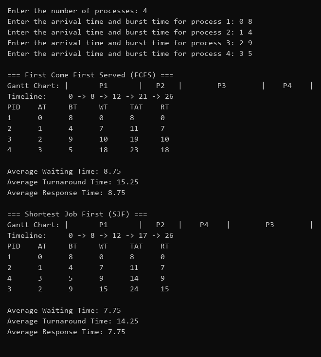
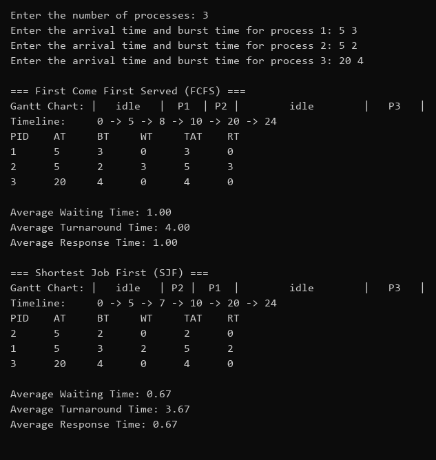

# Process Scheduling Simulator (FCFS & SJF)

Non-preemptive FCFS and SJF simulator in C. Prints a Gantt chart, per-process
WT/TAT/RT and averages for each algorithm. Idle CPU gaps are shown as `idle`.

## Build & run (Linux)

```bash
gcc -Wall -Wextra -o scheduler scheduler.c
./scheduler
```

Enter the number of processes, then `arrival_time burst_time` for each one.

## Notes

- SJF ties: shorter burst first, then earlier arrival, then lower PID.
- Metrics: TAT = completion - arrival; WT = TAT - burst; RT = first run - arrival
  (equal to WT for non-preemptive scheduling).
- For the sample input, SJF runs P1, P2, P4, P3 (non-preemptive: P1 is the only
  process at t=0). This matches the sample's table; the sample's SJF Gantt line
  (P2, P4, P1, P3) is inconsistent with its own numbers.

## Screenshots

Sample input from the assignment:



Edge case (same arrival times + idle CPU gap):



